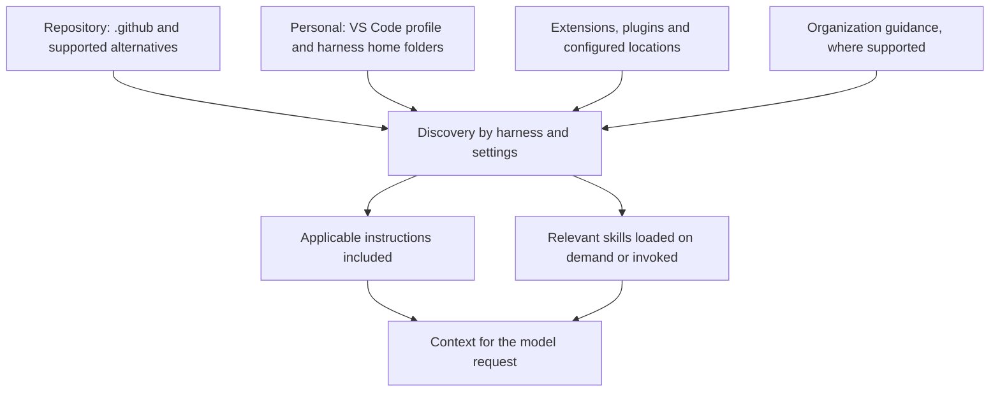

# Instructions

[Previous: Workshop README](../README.md) | [Next: Skills](02-skills.md)

## 1. What are instructions?

Reusable rules that guide **how Copilot should work**: coding conventions, documentation,
safety checks and team preferences. They save you repeating the same guidance in every prompt.

* Project-wide: `.github/copilot-instructions.md`, plain Markdown with no YAML required.
* Targeted: `.github/instructions/<topic>.instructions.md`, selected by file patterns,
   task relevance or manual attachment.

Minimal example, showing all documented VS Code instruction frontmatter fields:

```markdown
---
name: C# documentation
description: Use when creating or changing public C# APIs.
applyTo: '**/*.cs'
---

Add XML documentation to public classes and methods.
```

All three fields are optional: `name` is the display label, `description` helps task-based
discovery, and `applyTo` automatically attaches guidance for matching files being changed.
Without `description` or `applyTo`, attach the file manually. Use `applyTo: '**'` only for
rules relevant to every file.

## 2. Why instructions and skills?

* Instructions keep everyday work consistent: "Document every public C# API."
* Skills capture repeatable procedures: "Build the project and diagnose failures."
* Both make team knowledge reusable, reviewable and easier to maintain than repeated prompts.
* Neither guarantees compliance or changes tools by itself. A restore skill guides Copilot;
   it does not change what happens when you type `dotnet build` yourself.

See [Skills](02-skills.md) for task procedures, supporting files and invocation.
Keep rules short, descriptions specific and private configuration out of public examples.
Verify discovery and actual use in a fresh chat; inspect references and the resulting behavior.

## 3. Where do instructions and skills live?

Start in the repository's `.github/` folder for team-shared Copilot customizations.
It is not the only source: personal files, extensions and organization guidance can also
contribute context, even in a fresh chat. The selected agent harness (Copilot, Local,
Claude or Codex), not just the model, determines which locations are supported.

| Scope or source             | Instructions                                                                                             | Skills                                                        |
| --------------------------- | -------------------------------------------------------------------------------------------------------- | ------------------------------------------------------------- |
| Repository                  | `.github/copilot-instructions.md` and `.github/instructions/**/*.instructions.md`                        | `.github/skills/<name>/SKILL.md`                              |
| Repository alternatives     | Root or nested `AGENTS.md`; discovery depends on the harness and settings                                | Local also reads `.agents/skills/` and `.claude/skills/`      |
| VS Code user profile        | Local sessions: `*.instructions.md` in profile storage, created through **Chat: Open Customizations**    | Use a supported personal skill directory instead              |
| Personal Copilot folders    | Copilot harness: `~/.copilot/copilot-instructions.md` and `~/.copilot/instructions/**/*.instructions.md` | Copilot and Local: `~/.copilot/skills/<name>/SKILL.md`        |
| Other personal folders      | Harness-specific formats, such as `~/.claude/CLAUDE.md`                                                  | Local also reads `~/.agents/skills/` and `~/.claude/skills/`  |
| Additional configured paths | `chat.instructionsFilesLocations` adds search locations                                                  | Local's deprecated `chat.agentSkillsLocations` adds locations |
| Extensions and plugins      | Can contribute instructions or rules, depending on the harness                                           | Can contribute bundled skills                                 |
| Organization                | Managed on GitHub; availability depends on the client, account and settings                              | Do not assume a corresponding organization skill folder       |

On Windows, the default VS Code profile commonly stores instructions under
`%APPDATA%/Code/User/prompts/`. Named profiles can use different profile storage.
Personal Copilot skills instead live under `%USERPROFILE%/.copilot/skills/`.
These are separate mechanisms: the profile folder is not the personal skill folder,
and `.copilot/` can contain both instructions and skills.

`~` means the home directory where the agent runs. In a dev container, that can differ
from your Windows home directory. VS Code may also supply profile or extension files
from the host, so verify the actual paths in **Chat: Open Customizations** for that session.

### Discovery is not a precedence hierarchy

The arrows below show sources contributing to a request, not which source wins:



For Copilot, applicable user and repository instructions are combined without a general
precedence order between instruction files. Local can also include multiple applicable
files. Do not assume that repository rules override personal rules, a more deeply nested
file always wins, or a skill overrides an instruction. Remove or narrow conflicting rules.
Other harnesses have their own combination rules; see the
[instruction combination reference](https://code.visualstudio.com/docs/agents/reference/custom-instructions-reference#_combine-instruction-sources).

Before a workshop demo, inspect both **Instructions** and **Skills**, including their source
paths. A fresh chat clears conversation history, not installed customizations. For a
controlled before/after comparison, disable the relevant personal customization first,
start a new chat, and verify what was actually included using
[Appendix B](appendices.md#appendix-b-debugging-and-analyzing-copilot-activity-optional).

For optional background on tokens and cost, see
[Appendix A](appendices.md#appendix-a-tokens-and-cost-optional).

[Previous: Workshop README](../README.md) | [Next: Skills](02-skills.md)
