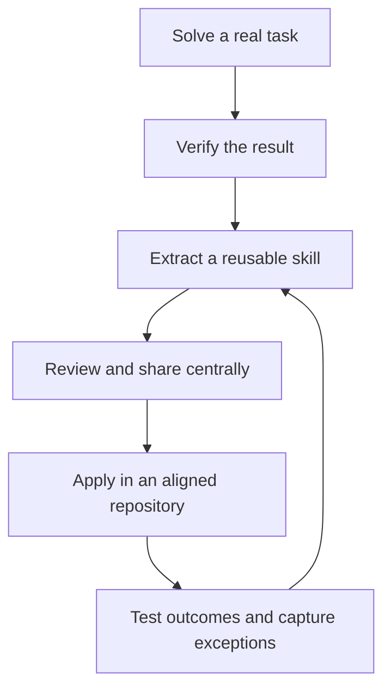

# Lessons learned from the field

[Previous: Modify the App](03-modify-the-app.md) | [Next: Workshop README](../README.md)

## Contents

1. [Give the agent a team playbook](#1-give-the-agent-a-team-playbook)
2. [Centralise shared knowledge, keep project details local](#2-centralise-shared-knowledge-keep-project-details-local)
3. [Turn a successful session into a reusable skill](#3-turn-a-successful-session-into-a-reusable-skill)
4. [Share implementations where needed, approaches where useful](#4-share-implementations-where-needed-approaches-where-useful)
5. [Earn the right to be a lazy prompter](#5-earn-the-right-to-be-a-lazy-prompter)
6. [Treat context as a limited resource](#6-treat-context-as-a-limited-resource)
7. [Look beyond shorter prompts](#7-look-beyond-shorter-prompts)
8. [Close the feedback loop](#8-close-the-feedback-loop)
9. [Guidance is not enforcement](#9-guidance-is-not-enforcement)

Instructions and skills turn hard-won experience into reusable team knowledge.
The payoff is not a perfect agent: it is less repeated explanation, a clearer starting
point and a repeatable way to improve how the team works.

## 1. Give the agent a team playbook

* Use instructions for everyday norms: architecture, naming, documentation and safety rules.
* Use skills for repeatable tasks: adding a feature, diagnosing a failure or migrating an API.
* Include examples, decision points and verification commands, not just "follow best practices".

This gives agentic developers a pre-built working model of team and organisational
standards. It guides the agent; it does not train the underlying model or enforce compliance.

Skills are not limited to writing code. They can capture repeatable work across the
delivery and operations spectrum:

* GitOps: review desired-state changes, diagnose reconciliation failures and plan rollbacks.
* DevOps: investigate pipeline failures, prepare releases and verify deployments.
* Project management: refine work items, define acceptance criteria and prepare iteration plans.
* Programming: implement features, review changes, test behaviour and migrate dependencies.
* Networking: diagnose connectivity, review DNS and routing, and validate firewall changes.
* Infrastructure: plan provisioning, review infrastructure-as-code and investigate configuration drift.

The common ingredient is a repeatable procedure with clear inputs, decisions and checks,
not a particular language or job title. A skill supplies the method; the agent still
needs the appropriate tools, access and approvals to carry it out.

## 2. Centralise shared knowledge, keep project details local

Maintain shared instructions and skills in one reviewed store instead of copying them
into every repository. Fixes are easier to distribute, and copies have less opportunity
to drift. Keep each application's commands, exceptions and constraints beside its code.

See the public VS Code documentation for
[custom instructions](https://code.visualstudio.com/docs/copilot/customization/custom-instructions)
and [agent skills](https://code.visualstudio.com/docs/copilot/customization/agent-skills)
for supported customization locations and setup.

For a working example, see [my own repo here](https://github.com/f2calv/.github),
including its [workspace setup steps](https://github.com/f2calv/.github#add-to-a-workspace).

VS Code can discover shared customizations from repositories added as separate folders
in a multi-root workspace, where the selected harness supports it. A sibling clone on
disk is not enough. Verify availability in **Chat: Open Customizations** rather than
assuming every agent sees every workspace folder. For sessions that do not discover
the shared workspace root, use a supported personal customization location and
verify discovery again.

Give the shared store owners, review changes and agree how consumers receive updates.
A live checkout follows its checked-out branch after a pull; versioned distribution
offers a more controlled rollout. Centralisation also spreads mistakes more widely.

## 3. Turn a successful session into a reusable skill

After a long feature or debugging session, capture the method while the reasoning is
still available. Save the procedure, not the entire conversation.

1. Record when to use it, prerequisites and assumptions about compatible applications.
2. Extract the successful steps, diagnostic clues and approaches that failed and why.
3. Replace one-off paths and values with explicit inputs; remove secrets and private data.
4. Include tests, expected results and stopping conditions for unsupported situations.
5. Try it in a fresh chat and, where possible, another aligned repository before sharing.

For a bug, preserve how to recognise and confirm the cause, not a blanket instruction
to apply the same fix whenever a similar symptom appears.



## 4. Share implementations where needed, approaches where useful

Across languages, frameworks and topics, reusable implementations and reusable guidance
solve different problems. Whether you are standardising application configuration,
infrastructure, testing or documentation, choose based on what needs to stay identical.

| Approach | Useful when | Trade-off |
| --- | --- | --- |
| Shared library or tool | Projects need the same tested implementation or enforced behaviour. | Releases, compatibility and upgrades create coordination work. |
| Shared skill | Projects need a common approach with room for local adaptation. | Generated outputs can diverge; fixes must be reapplied and verified. |
| Both | Stable behaviour belongs in shared code or tooling; setup and workflows vary by project. | The skill and implementation guidance must stay aligned. |

A skill can be lighter to evolve in fast-moving projects, but it does not provide
the guarantees or single implementation of a shared library or tool. Often the best
skill teaches the agent to use existing packages, scripts or tooling correctly.

## 5. Earn the right to be a lazy prompter

The better the skill, the less procedure you need to repeat in the prompt.
"Add our standard telemetry setup" can be enough when the relevant skill provides
the decisions, examples and checks.

Be brief about the method, not the goal: still state the intended outcome, constraints
and acceptance criteria. Give skills specific discovery descriptions, and invoke one
explicitly when automatic selection misses it. Shorter prompts do not remove your
responsibility to review the result.

## 6. Treat context as a limited resource

* Keep always-on instructions short; scope specialised rules to the files that need them.
* Give each skill a clear purpose and move detailed references into supporting files.
* Remove duplicate, stale and contradictory guidance, including extension and personal rules.
* Prefer a tested script or formatter for mechanical checks over pages of prose.

Discovery metadata costs tokens too. Skill bodies load on demand, but once loaded
can remain in conversation context. Excess text consumes context capacity and can
increase usage costs, depending on the plan and model; tokens are not a direct billing
formula. See [Appendix A](appendices.md#appendix-a-tokens-and-cost-optional).

## 7. Look beyond shorter prompts

Other practical benefits to look for in your own team:

* Faster onboarding: new contributors can use the same procedures as experienced teammates.
* Less dependence on one expert: diagnostic reasoning survives beyond the original author.
* Reviewable standards: pull requests make changes to the team's guidance visible and reversible.
* More repeatable migrations: a skill can carry an ordered checklist across aligned repositories.
* Clearer handoffs: explicit prerequisites, outputs and checks make unfinished work easier to resume.
* Reuse across compatible agents: the Agent Skills format is portable, though tools and discovery vary.

These are benefits to validate, not guaranteed productivity gains. Compare similar
tasks before and after: repeated corrections, review rework, time to a verified result
and whether required checks actually ran.

## 8. Close the feedback loop

Creating instructions and skills is only the start. Ask the agent to update existing
guidance as part of completing features, fixing bugs and responding to review feedback.
This keeps the team's playbook accurate, up to date and evolving with the codebase,
rather than preserving assumptions from the day it was written.

* Treat repeated corrections, failed commands and changed APIs as maintenance signals.
* Update the existing rule or procedure instead of appending competing instructions.
* Keep application-specific exceptions local; share lessons that genuinely apply across repositories.
* Remove obsolete steps and verify replacement commands, examples and expected results.
* Test revised guidance in a fresh session and review the diff before distributing it.

Make maintenance part of the workflow, for example:

```text
Before finishing this task, check whether our instructions or skills caused repeated
corrections or contain outdated steps. Update the relevant existing guidance with
verified, reusable lessons. Keep one-off exceptions local, remove superseded advice,
and show the guidance changes separately for review. If no update is needed, say so.
```

Automate the maintenance work, not unquestioning acceptance of every lesson. The agent
can propose or make authorised edits, but shared changes still need validation and
the team's normal review process. One successful workaround is not automatically a
new standard. Copilot does not maintain these files by itself unless your workflow
explicitly asks it to do so and permits the edits.

## 9. Guidance is not enforcement

Instructions and skills can be ignored, misapplied or outdated. Keep security controls,
CI checks, tests and human review independent of the agent's willingness to follow text.
Review shared scripts before allowing them to run.

Test discovery and behaviour separately in a fresh session. Check what was loaded,
then inspect the code and tool activity. Our Markdown frontmatter detour is a small
example: an installed extension supplied a documentation rule that did not fit this
repository. More guidance is not always better guidance.

For diagnostics, see [Appendix B](appendices.md#appendix-b-debugging-and-analyzing-copilot-activity-optional).
For supported behaviour, see the VS Code references for
[instructions](https://code.visualstudio.com/docs/copilot/customization/custom-instructions)
and [skills](https://code.visualstudio.com/docs/copilot/customization/agent-skills).

[Previous: Modify the App](03-modify-the-app.md) | [Next: Workshop README](../README.md)
