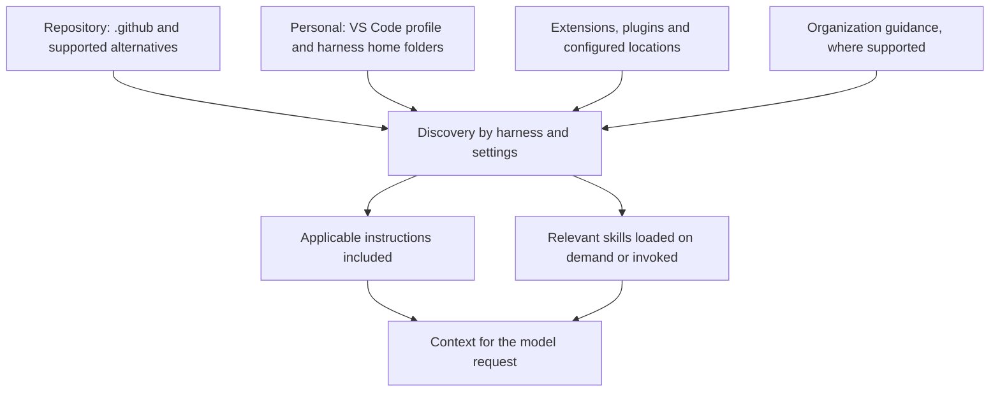

# Appendices

## Appendix A: Tokens and cost (optional)

Instructions and skills are extra text supplied to the model behind the scenes. That text
uses input tokens and takes up space in its context window, even when you do not type it
into the chat yourself.

* Project-wide instructions are included in applicable requests. Long, always-on rules
   create a recurring context cost.
* C# instructions with `applyTo: '**/*.cs'` are automatically attached when Copilot creates
   or changes matching files. Their text can accompany successive model requests, not just
   the first prompt. Merely asking a read-only question about C# does not guarantee that
   pattern-based instructions are attached; task relevance or manual attachment can also load them.
* Skills load progressively. Copilot sees the available skills' names and descriptions,
   then selects a skill when those suggest it is relevant. The full body is loaded on demand,
   followed by supporting files only as needed. Discovery still costs tokens, and automatic
   selection is not guaranteed.
* Once loaded, a skill can remain in the conversation context and contribute to later
   requests. On-demand loading does not mean its token cost disappears immediately afterward.

Keep everyday rules short and narrowly scoped; put detailed, task-specific procedures in skills.
Both can also save tokens overall by reducing repeated explanations, failed attempts and rework.

More input tokens do not necessarily mean a proportional increase in your bill: actual charges
depend on your Copilot plan, selected model, billing rules and any prompt caching.

## Appendix B: Debugging and analyzing Copilot activity (optional)

Do not rely only on asking Copilot "Did you use my instructions?" Check the evidence for
the affected request. These are different stages:

| Stage | What to look for | What it does not prove |
| --- | --- | --- |
| Discovered | The file appears in customization diagnostics or the Agent Customizations editor. | That it was selected for this request. |
| Selected or loaded | Discovery events, response references, or a tool call reading the skill body. | That all of its content reached a particular model request. |
| Sent | The expected text appears in that request's prompt, context or tool results. | That the model followed it. |
| Followed | Generated code and tool activity satisfy the rule or procedure. | That the customization caused the behavior; compare a controlled before/after run. |

### Where to look

* Run **Chat: Open Customizations** from the Command Palette and inspect **Instructions**
   or **Skills** for the selected agent. Check the actual file path, not just its display name.
   In a dev container, inspect the container session, not a separate host window.
* In the Chat view's context menu, select **Diagnostics** to check discovered instructions
   and parsing errors. A missing file suggests a location, naming, discovery-setting or
   frontmatter problem. Available menus vary with the VS Code version and agent harness.
* Expand **References** on the response and inspect the agent's tool activity. For skills,
   look for a skill invocation or a read of the actual `SKILL.md` body. A name and description
   in the available-skill list mean discovery, not full-body loading.
* Run **Developer: Open Agent Debug Logs**, or choose **Show Agent Debug Logs** from Chat's
   `...` menu. Select the affected session and filter **Discovery**, model requests, tool calls
   and errors. Check whether the file was loaded, skipped or rejected, and why.
* Run **Developer: Show Chat Debug View**, or choose **Show Chat Debug View** from Chat's
   overflow menu. Inspect the affected request's **System prompt**, **User prompt**,
   **Context** and **Tool responses**. Search for the file path or a distinctive sentence
   from its body. A skill may enter context through a tool result, not the initial system prompt.
* Use the debug panel's **Summary** for reported token usage, tool calls, errors and duration;
   its **Agent Flow Chart** helps trace subagent work. If cache reuse is unexpectedly low,
   **Cache Explorer** compares consecutive requests. These are diagnostics, not a billing statement.
* For extension or connectivity errors, open **View > Output** and select **GitHub Copilot**
   or **GitHub Copilot Chat**, where available. Temporarily use **Developer: Set Log Level**
   to enable **Trace**, reproduce the problem, then restore the previous level.

### Capture before reproducing

Agent Debug Logs are a preview feature. Enable the appropriate experimental setting before
the run you want to inspect; capture is not retroactive:

* Agent Host sessions: `chat.agentHost.agentDebugLog.enabled`.
* Local harness sessions: `github.copilot.chat.agentDebugLog.fileLogging.enabled`;
   reload VS Code before using `/troubleshoot`.

Where supported, ask `/troubleshoot Which customizations were loaded, skipped or rejected?`
to analyze the captured events. Treat its answer as a summary to verify against those events.

### A quick verification exercise

1. Start a fresh chat with the intended agent, model and workspace.
2. Ask for a small change with an observable requirement, such as XML comments on a public C# method.
3. Check discovery, request content and the resulting code separately.
4. For a skill, compare automatic selection with an explicit `/skill-name` invocation in another
    fresh chat. If explicit invocation works but automatic selection does not, review the description
    and `disable-model-invocation`; if the slash command is missing, check `user-invocable`.
5. Change one condition at a time and repeat the same task. Check glob matching, malformed YAML,
    duplicate names, conflicting user/repository rules, approvals and failed tool calls.

A read of a skill or a reference badge is evidence of loading, not proof of compliance.
Conversely, an absent badge alone is not proof that the model never received the content.

Debug views and exports can contain source code, prompts, local paths and tool output.
Remove private data and credentials before screen-sharing or publishing logs.

References: [VS Code custom instructions](https://code.visualstudio.com/docs/copilot/customization/custom-instructions),
[VS Code skills](https://code.visualstudio.com/docs/copilot/customization/agent-skills),
the [Agent Skills specification](https://agentskills.io/specification),
[debugging chat interactions](https://code.visualstudio.com/docs/agents/agent-troubleshooting/chat-debug-view),
and [Copilot troubleshooting](https://code.visualstudio.com/docs/agents/agent-troubleshooting/troubleshooting).

## Appendix C: Where do instructions and skills live? (optional)

Start in the repository's `.github/` folder for team-shared Copilot customizations.
It is not the only source: personal files, extensions and organization guidance can also
contribute context, even in a fresh chat. The selected agent harness (Copilot, Local,
Claude or Codex), not just the model, determines which locations are supported.

| Scope or source | Instructions | Skills |
| --- | --- | --- |
| Repository | `.github/copilot-instructions.md` and `.github/instructions/**/*.instructions.md` | `.github/skills/<name>/SKILL.md` |
| Repository alternatives | Root or nested `AGENTS.md`; discovery depends on the harness and settings | Local also reads `.agents/skills/` and `.claude/skills/` |
| VS Code user profile | Local sessions: `*.instructions.md` in profile storage, created through **Chat: Open Customizations** | Use a supported personal skill directory instead |
| Personal Copilot folders | Copilot harness: `~/.copilot/copilot-instructions.md` and `~/.copilot/instructions/**/*.instructions.md` | Copilot and Local: `~/.copilot/skills/<name>/SKILL.md` |
| Other personal folders | Harness-specific formats, such as `~/.claude/CLAUDE.md` | Local also reads `~/.agents/skills/` and `~/.claude/skills/` |
| Additional configured paths | `chat.instructionsFilesLocations` adds search locations | Local's deprecated `chat.agentSkillsLocations` adds locations |
| Extensions and plugins | Can contribute instructions or rules, depending on the harness | Can contribute bundled skills |
| Organization | Managed on GitHub; availability depends on the client, account and settings | Do not assume a corresponding organization skill folder |

On Windows, the default VS Code profile commonly stores instructions under
`%APPDATA%/Code/User/prompts/`. Named profiles can use different profile storage.
Personal Copilot skills instead live under `%USERPROFILE%/.copilot/skills/`.
These are separate mechanisms: the profile folder is not the personal skill folder,
and `.copilot/` can contain both instructions and skills.

`~` means the home directory where the agent runs. In a dev container, that can differ
from your Windows home directory. VS Code may also supply profile or extension files
from the host, so verify the actual paths in **Chat: Open Customizations** for that session.

### Discovery is not a precedence hierarchy

The arrows below show sources contributing to a request, not which source wins:

For Copilot, applicable user and repository instructions are combined without a general
precedence order between instruction files. Local can also include multiple applicable
files. Do not assume that repository rules override personal rules, a more deeply nested
file always wins, or a skill overrides an instruction. Remove or narrow conflicting rules.
Other harnesses have their own combination rules; see the
[instruction combination reference](https://code.visualstudio.com/docs/agents/reference/custom-instructions-reference#_combine-instruction-sources).

Before a workshop demo, inspect both **Instructions** and **Skills**, including their source
paths. A fresh chat clears conversation history, not installed customizations. For a
controlled before/after comparison, disable the relevant personal customization first,
start a new chat, and verify what was actually included using
[Appendix B](#appendix-b-debugging-and-analyzing-copilot-activity-optional).

For optional background on tokens and cost, see
[Appendix A](#appendix-a-tokens-and-cost-optional).

[Back to instructions](01-instructions.md) | [Back to skills](02-skills.md)

[Back to workshop README](../README.md)
